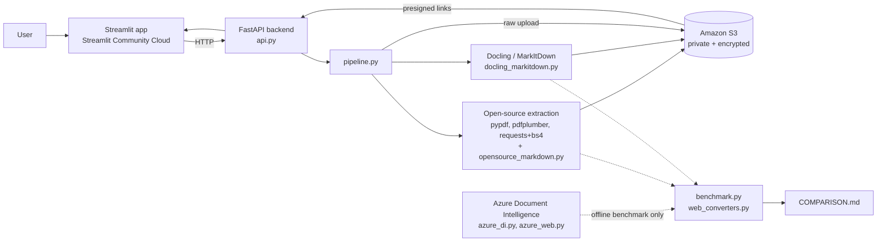

# Unstructured Data Ingestion Pipeline

Turns PDFs and web pages into clean, reading-order **Markdown**, stores everything in a private, encrypted **Amazon S3** bucket, and exposes it through a **FastAPI** backend and a **Streamlit** web app.

- **Live app:** `http://10.46.238.193:8501/
- **Live API:** `http://127.0.0.1:8000 (interactive docs at `/docs`)
- **Demo video:** `<link>`
- **Three-way tool comparison (Task 3):** [COMPARISON.md](COMPARISON.md)

---

## What it does

| Layer | What happens | Tools |
|-------|--------------|-------|
| 1. Extraction | Pull text, tables, images, layout from PDFs and web pages | **Open-source:** pypdf, pdfplumber, requests + BeautifulSoup. **Enterprise:** Azure AI Document Intelligence (Layout) |
| 2. Standardization | Convert to Markdown, with images saved separately and linked | Docling, MarkItDown (plus our own reassembly of the open-source pieces) |
| 3. Storage | Organized, searchable, private, encrypted S3 layout | boto3 |
| 4. Access | Upload a PDF or paste a URL, choose a tool, get Markdown | FastAPI + Streamlit |

---

## Architecture



**How the pieces fit**

1. The **Streamlit app** sends the PDF or URL (and the chosen tool) to the **FastAPI backend**. It does no conversion itself.
2. The backend calls `pipeline.py`, which saves the original to S3, runs the chosen tool, uploads extracted images, rewrites the Markdown's image links to point at S3, and uploads the Markdown.
3. The API returns the Markdown plus links to every stored file (`s3://` URIs and temporary presigned download URLs). The bucket itself stays private.
4. **Azure Document Intelligence** is used in the Task 1–3 benchmark scripts (not in the live API), so the app does not need Azure credentials to run.

---

## Project structure

```
.
├── app/
│   ├── api.py                  FastAPI backend (Task 6)
│   ├── pipeline.py             glue: extract/standardize -> S3
│   ├── extractor.py            pypdf + pdfplumber: text, tables, layout, images (Task 1)
│   ├── opensource_markdown.py  reassembles those pieces into one reading-order .md
│   ├── webscraper.py           requests + BeautifulSoup scraper + HTML -> Markdown (Task 2)
│   ├── azure_di.py             Azure Layout for PDFs, handles the free-tier 2-page limit
│   ├── azure_web.py            Azure Layout for web pages
│   ├── docling_markitdown.py   Docling and MarkItDown converters (Task 4)
│   ├── benchmark.py            PDF benchmark: open-source vs Docling vs MarkItDown vs Azure (Task 3)
│   ├── web_converters.py       web benchmark: bs4 vs Docling vs MarkItDown
│   ├── s3_storage.py           S3 layout, metadata, tags, encryption (Task 5)
│   ├── setup_bucket.py         one-time: create the private, encrypted bucket
│   └── seed_bucket.py          fill the bucket by running the real pipeline
├── frontend/
│   ├── streamlit_app.py        Streamlit UI (Task 6)
│   └── requirements.txt        streamlit, requests only
├── data/
│   ├── input/                  test PDFs (and input/web/ for saved pages)
│   └── output/                 results of every script
├── COMPARISON.md               three-way comparison write-up
├── requirements.txt            backend dependencies
└── .env                        your secrets (NEVER commit; see .env.example)
```

---

## Setup

### Prerequisites
- Python 3.10 or newer
- An AWS account with an access key (an IAM user limited to S3 is best)
- An Azure AI Document Intelligence resource
- Docling downloads AI models on first use, so allow a few GB of disk and a slow first run

### 1. Clone and install
```bash
git clone <https://github.com/jencyviyagappanamalraj-wq/Unstructured-Data-Ingestion-Pipeline>
cd <Unstructured-Data-Ingestion-Pipeline>
python -m venv .venv
source .venv/bin/activate          # Windows: .venv\Scripts\activate
pip install -r requirements.txt
```

### 2. Configure environment variables
Create a `.env` file in the project root (it is git-ignored):

```env
# --- AWS / S3 (required) ---
AWS_ACCESS_KEY_ID=your-access-key-id
AWS_SECRET_ACCESS_KEY=your-secret-access-key
AWS_REGION=ap-southeast-2
S3_BUCKET=ingestion-pipeline-byjency-2026

# --- Azure Document Intelligence (only for the benchmark scripts) ---
AZURE_DI_ENDPOINT=https://your-resource.cognitiveservices.azure.com/
AZURE_DI_KEY=your-azure-key
AZURE_CHUNK_PAGES=2        # free tier (F0) reads only 2 pages per request; 
```

Never commit keys. Commit a `.env.example` with empty values instead.

### 3. Create the S3 bucket (once)
```bash
python app/setup_bucket.py ingestion-pipeline-byjency-2026
```
This creates a bucket with **public access fully blocked**, **default AES-256 encryption**, and **versioning** on.

### 4. Add your test files
Put PDFs in `data/input/`. The comparison uses multimodal arXiv papers (headings, multi-column text, tables, formulas, key-value blocks, figures).

---

## Run it locally

**Backend** (from the project root):
```bash
uvicorn api:app --app-dir app --reload
```
Interactive API docs: http://127.0.0.1:8000/docs

**Front end** (second terminal):
```bash
pip install -r frontend/requirements.txt
streamlit run frontend/streamlit_app.py
```
The app talks to `http://127.0.0.1:8000` by default. Choose a tool (Docling, MarkItDown or open-source), upload a PDF or enter a URL, then view or download the Markdown.

### API endpoints

| Method | Path | Purpose |
|--------|------|---------|
| POST | `/pdf/extract` | Upload a PDF; open-source extraction (pypdf + pdfplumber) and reassembled Markdown |
| POST | `/pdf/standardize?tool=docling\|markitdown` | Upload a PDF; Markdown via Docling or MarkItDown |
| POST | `/url/extract` | Submit a URL (JSON `{"url": ...}`); requests + BeautifulSoup scrape and Markdown |
| POST | `/url/standardize?tool=docling\|markitdown` | Submit a URL; Markdown via Docling or MarkItDown |
| GET | `/documents` | List stored Markdown files |
| GET | `/documents/markdown?key=...` | Fetch one stored Markdown file (image links made viewable) |
| GET | `/health` | Status check |

Limits: PDFs up to 25 MB; the PDF header is validated; web fetches respect `robots.txt`.

---

## Reproducing the comparison (Tasks 1–4)

```bash
python app/extractor.py              # open-source PDF extraction (text, tables, layout, images)
python app/opensource_markdown.py    # open-source pieces reassembled into Markdown
python app/azure_di.py               # Azure Layout on every PDF -> data/output/azure/
python app/docling_markitdown.py     # Docling + MarkItDown Markdown
python app/benchmark.py              # PDF benchmark -> data/output/benchmark/benchmark.csv
python app/webscraper.py             # open-source web scrape
python app/web_converters.py         # Docling + MarkItDown on the same pages (+ bs4 row)
python app/azure_web.py              # Azure on the same pages
```
Results and conclusions are written up in [COMPARISON.md](COMPARISON.md).

**Azure free tier:** it analyses only the first 2 pages of each PDF, so `azure_di.py` splits the PDF into 2-page pieces and joins the Markdown. Tables that cross a split are cut in two.

---

## Storage layout (S3)

All keys are lowercase with no spaces.

```
raw/pdf/<source>/<YYYY-MM-DD>/<docid>.pdf              original uploads
raw/html/<source>/<YYYY-MM-DD>/<docid>.html            fetched web pages
processed/markdown/<tool>/<source>/<docid>.md          final Markdown
processed/extracted/<tool>/<source>/<docid>/<file>     open-source output (txt, json)
assets/images/<source>/<docid>/<image>                 images linked from the Markdown
```

- `<source>` is `uploaded` for user PDFs, or the site name for web pages (e.g. `en-wikipedia-org`).
- `<tool>` is `docling`, `markitdown`, or `pypdf-pdfplumber` / `requests-bs4` for open-source.
- `<docid>` is `<slugified-name>-<8-char content hash>`, so the same document always maps to the same keys.

To find a document: use its `docid` to locate the Markdown under `processed/markdown/` and its images under `assets/images/<source>/<docid>/`. The Markdown links to those images by `s3://` URI, and the API converts them to temporary HTTPS links for display.

**Metadata** on every object: `source-url`, `tool`, `processed-date`, `doc-type` (plus processing seconds and image count where relevant).
**Tags:** `tool`, `doctype`, `date` (for filtering and access rules).
**Security:** public access blocked at bucket level, AES-256 encryption at rest, versioning on, and access only through presigned links that expire after one hour.

`python app/seed_bucket.py` fills the bucket by running the real pipeline and writes the listing to `docs/s3_listing.txt`.

---

## Deployment

### Backend (public FastAPI)
The backend needs a public URL and enough RAM for Docling (about 4 GB or more recommended). Options: Render

1. Start `uvicorn api:app --app-dir app` on the port your host expects.
2. Set these as **secrets/environment variables on the host**, not in the image: `AWS_ACCESS_KEY_ID`, `AWS_SECRET_ACCESS_KEY`, `AWS_REGION`, `S3_BUCKET`.
3. Check `http://127.0.0.1:8000/health`.

On a small host without Docling, the API still works for MarkItDown and open-source: Docling endpoints return a clear "not installed" message.

### Front end (Streamlit Community Cloud)
1. Push the repo to GitHub.
2. On https://share.streamlit.io create an app with main file `frontend/streamlit_app.py` (it uses `frontend/requirements.txt`, so Docling is not installed there).
3. In the app's **Secrets**, add:
   ```toml
   BACKEND_URL = "http://127.0.0.1:8000"
   ```

---

## Choosing a tool (summary)

See [COMPARISON.md](COMPARISON.md) for measured accuracy, speed, ease of use, cost and scalability.

| Need | Use |
|------|-----|
| Structure-preserving Markdown from complex PDFs | Docling (slowest) |
| Fast, simple conversion | MarkItDown |
| Raw tables, images and layout data, full control | pypdf / pdfplumber / BeautifulSoup |
| Managed service, no local models | Azure Document Intelligence (per-page cost, documents leave your machine) |

---

## Known limitations
- The open-source Markdown assembler keeps formulas and key-value blocks as plain text, misses vector-drawn figures, and may mis-order complex layouts.
- Azure's free tier reads 2 pages per request; the splitting workaround can cut tables that span a split.
- Docling is slow on large PDFs and memory-hungry.
- Only a small test set was evaluated; counts show quantity, not correctness.

## Ground rules followed
Only permitted pages are scraped (robots.txt respected, descriptive User-Agent). No credentials are committed. Buckets are private by default. Test-set content is not republished.
